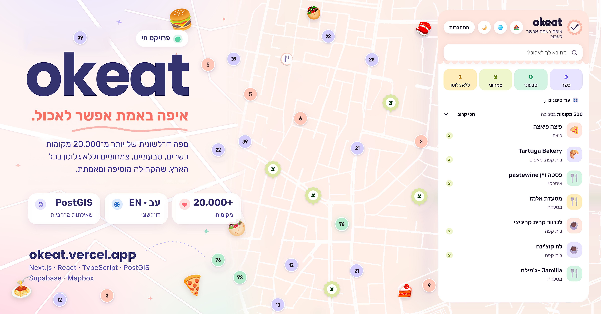
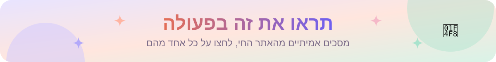
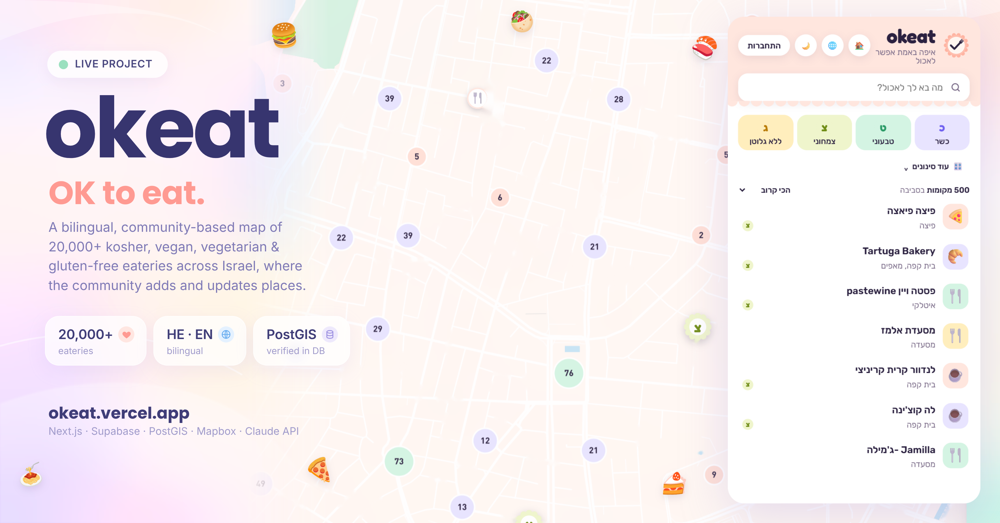
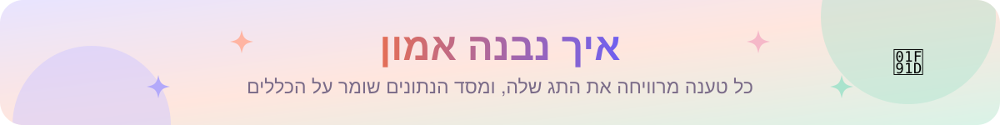
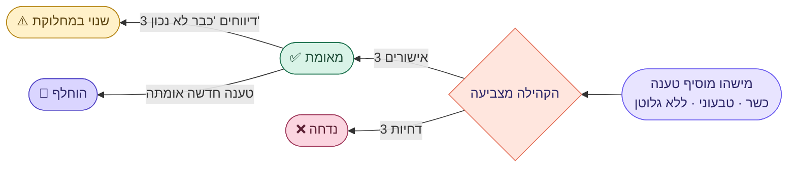
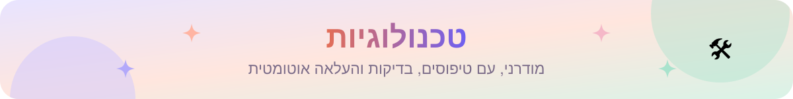
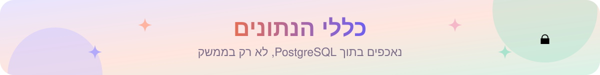
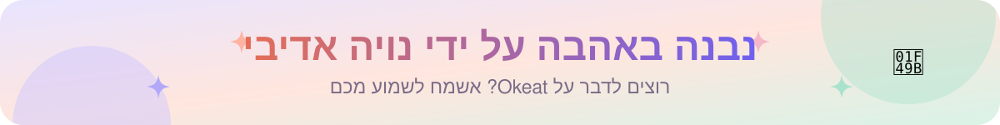

<div dir="rtl">

<p align="center">
  <a href="https://okeat.vercel.app">
    
  </a>
</p>

<p align="center"><a href="README.md">English</a> · <b>עברית</b></p>

<p align="center">
  <a href="https://okeat.vercel.app"></a>
  <a href="https://okeat.vercel.app/map"></a>
  <a href="docs/ARCHITECTURE.md"></a>
</p>

<p align="center">
  <a href="https://github.com/NoyaAdivi/Okeat/actions/workflows/tests.yml"></a>
  <a href="LICENSE"></a>
  <a href="https://github.com/NoyaAdivi/Okeat/commits/main"></a>
  <a href="https://github.com/NoyaAdivi/Okeat"></a>
</p>

<h3 align="center">איפה באמת אפשר לאכול, בלי לנחש.</h3>

<p align="center">
  Okeat היא מפה דו־לשונית של יותר מ־<b>20,000</b> מקומות אוכל כשרים, טבעוניים, צמחוניים וללא גלוטן בכל הארץ.<br>
  אנשים מוסיפים מקומות, אחרים מאשרים אותם, ומסד הנתונים עצמו אוכף כל כלל.
</p>

<table align="center">
  <tr>
    <td align="center" width="25%"><a href="https://okeat.vercel.app/map"><b>🗺️ 20,000+</b></a><br><sub>מקומות על המפה</sub></td>
    <td align="center" width="25%"><a href="#how-trust-works"><b>✅ 3</b></a><br><sub>אישורים לכל טענה</sub></td>
    <td align="center" width="25%"><a href="https://okeat.vercel.app/cities"><b>🌍 עב · EN</b></a><br><sub>דו־לשוני מלא, מימין לשמאל</sub></td>
    <td align="center" width="25%"><a href="https://github.com/NoyaAdivi/Okeat/actions/workflows/tests.yml"><b>🧪 CI</b></a><br><sub>בדיקות בכל עדכון</sub></td>
  </tr>
</table>

<a name="highlights"></a>
<p align="center"><a href="#highlights"></a></p>

<table dir="rtl">
  <tr valign="top">
    <td valign="top" width="33%" dir="rtl">
      <p><b>🗺️ למצוא איפה לאכול</b></p>
      <ul>
        <li><a href="https://okeat.vercel.app/map"><b>מפה ארצית</b></a> עם קיבוץ נקודות, כדי שתישאר מהירה</li>
        <li><b>סינון לפי מה שחשוב:</b> רמת כשרות וגוף משגיח, טבעוני, צמחוני, ללא גלוטן ואלרגיות</li>
        <li><b>חיפוש חכם:</b> "פיצה כשרה פתוחה עכשיו ברמת גן" הופך לסינונים ולעיר</li>
        <li><b>ניווט צעד אחר צעד</b> עם הנחיה קולית בעברית</li>
      </ul>
    </td>
    <td valign="top" width="33%" dir="rtl">
      <p><b>🤝 מידע שאפשר לסמוך עליו</b></p>
      <ul>
        <li><b>כל טענה צריכה 3 אישורים,</b> ואי אפשר לאשר טענה של עצמך</li>
        <li><b>תעודות כשרות</b> מצלמים, והן נקראות ב־OCR</li>
        <li><b>הכללים נמצאים במסד הנתונים</b> (RLS וטריגרים)</li>
        <li><b>מנהלי תוכן</b> שממנה המנהל מטפלים במקומות שדווחו</li>
      </ul>
    </td>
    <td valign="top" width="33%" dir="rtl">
      <p><b>💛 בנוי כמו מוצר אמיתי</b></p>
      <ul>
        <li><b>ביקורות, מקומות שמורים, רשימות לשיתוף</b> והעלאת תמונות עם אישור</li>
        <li><b>בעלי עסקים</b> מוכיחים בעלות בעזרת קוד</li>
        <li><b>מרכז ניהול</b> שמזהה לבד כפילויות ומיקומים לא מדויקים</li>
        <li><a href="https://okeat.vercel.app/accessibility"><b>תפריט נגישות</b></a>, מצב כהה ואפליקציה שאפשר להתקין</li>
      </ul>
    </td>
  </tr>
</table>

<a name="see-it-in-action"></a>
<p align="center"><a href="#see-it-in-action"></a></p>

<p align="center">
  <a href="https://okeat.vercel.app/map"></a>
</p>

<p align="center">
  <a href="https://okeat.vercel.app"><b>דף הבית</b></a> ·
  <a href="https://okeat.vercel.app/map"><b>מפה</b></a> ·
  <a href="https://okeat.vercel.app/cities"><b>ערים</b></a> ·
  <a href="https://okeat.vercel.app/about"><b>איך זה עובד</b></a> ·
  <a href="https://okeat.vercel.app/accessibility"><b>נגישות</b></a>
</p>

<a name="how-trust-works"></a>
<p align="center"><a href="#how-trust-works"></a></p>

</div>



<div dir="rtl">

<p align="center"><sub>אי אפשר להצביע על טענה שהצעת בעצמך. מידע מיובא או אוטומטי מסומן ולעולם לא נחשב כמאומת על ידי הקהילה.</sub></p>

<a name="tech-stack"></a>
<p align="center"><a href="#tech-stack"></a></p>

<p align="center"><b>אפליקציה</b><br>
<a href="https://nextjs.org"></a>
<a href="https://react.dev"></a>
<a href="https://www.typescriptlang.org"></a>
</p>

<p align="center"><b>נתונים</b><br>
<a href="https://supabase.com"></a>
<a href="https://www.postgresql.org"></a>
<a href="https://postgis.net"></a>
<a href="https://www.openstreetmap.org"></a>
</p>

<p align="center"><b>מפות ובינה מלאכותית</b><br>
<a href="https://www.mapbox.com"></a>
<a href="https://tesseract-ocr.github.io"></a>
<a href="https://www.anthropic.com/claude"></a>
</p>

<p align="center"><b>העלאה ובדיקות</b><br>
<a href="https://vercel.com"></a>
<a href="https://github.com/NoyaAdivi/Okeat/actions"></a>
<a href="https://playwright.dev"></a>
</p>

<details>
<summary><b>🏗️ הארכיטקטורה במבט אחד</b></summary>
<br>

הדפדפן מדבר ישירות עם מסד הנתונים, ולכן כללי הגישה נמצאים ב־PostgreSQL ונשמרים גם בלי האתר. הסבר מלא ב־[docs/ARCHITECTURE.md](docs/ARCHITECTURE.md).

</details>

<a name="data-rules"></a>
<p align="center"><a href="#data-rules"></a></p>

| כלל | איפה |
|---|---|
| 3 אישורים → `verified`, 3 דחיות → `rejected` | `apply_vote()` |
| אי אפשר להצביע על טענה שהצעת | `apply_vote()` |
| טענה חדשה שאומתה מחליפה את הקודמת | `apply_vote()` |
| 3 דיווחים "כבר לא נכון" → `disputed` | `apply_vote()` |
| כשרות עם תמונה או בלי; תעודה שפג תוקפה מפסיקה להיחשב | `effective_claims` |
| 3 דיווחים על מקום → מנהלי התוכן מחליטים | `after_report()`, `moderate_place()` |
| מנהלי תוכן ממונים על ידי המנהל; אי אפשר לשנות לעצמך תפקיד | הרשאות עמודה |
| אישור בעלות דורש מנהל | `decide_ownership()` |
| מידע מיובא או אוטומטי מסומן ולא נחשב כמאומת | `claims.source` |
| הגבלת קצב על קריאת תעודות והודעות יצירת קשר | `log_extraction()`, `feedback_rate_limit()` |

<a name="run-locally"></a>
<p align="center"><a href="#run-locally"></a></p>

1. פותחים חשבונות חינמיים: [Supabase](https://supabase.com), [Mapbox](https://mapbox.com), [Anthropic](https://console.anthropic.com).
2. ב־Supabase, בתוך SQL Editor, מריצים את הקבצים שב־`supabase/migrations/` לפי הסדר.
3. מעתיקים את `.env.example` ל־`.env.local` וממלאים את המפתחות.
4. מתקינים ומפעילים:

</div>

```bash
npm install
npm run dev
```

<div dir="rtl">

&nbsp;&nbsp;&nbsp;בדיקת הקוד: `npm run typecheck` ו־`npm test`.

5. ממלאים את המפה:

</div>

```bash
npm run import:osm
npm install @duckdb/node-api && npm run import:overture
npm run classify
npm run classify:diet
```

<div dir="rtl">

> [!IMPORTANT]
> המפתח `SUPABASE_SERVICE_ROLE_KEY` נועד רק לסקריפטים של הייבוא במחשב שלך. אסור לשים אותו בדפדפן או בהגדרות האחסון.

<details>
<summary><b>🙏 קרדיטים</b></summary>
<br>
נתוני המקומות © תורמי <a href="https://www.openstreetmap.org/copyright">OpenStreetMap</a> (ODbL) ו־<a href="https://overturemaps.org">Overture Maps Foundation</a> (CDLA Permissive 2.0). המפה © Mapbox.
</details>

<a name="contact"></a>
<p align="center"><a href="#contact"></a></p>

<p align="center">
  <a href="https://okeat.vercel.app"></a>
  <a href="https://www.linkedin.com/in/noya-adivi/"></a>
  <a href="https://noyaadivi.github.io/noya-website"></a>
  <a href="https://github.com/NoyaAdivi"></a>
</p>

</div>
