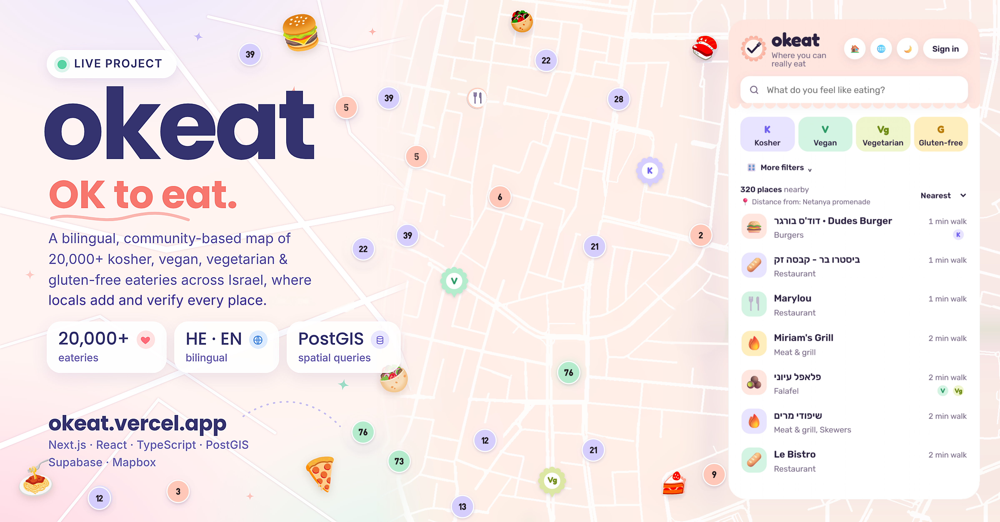
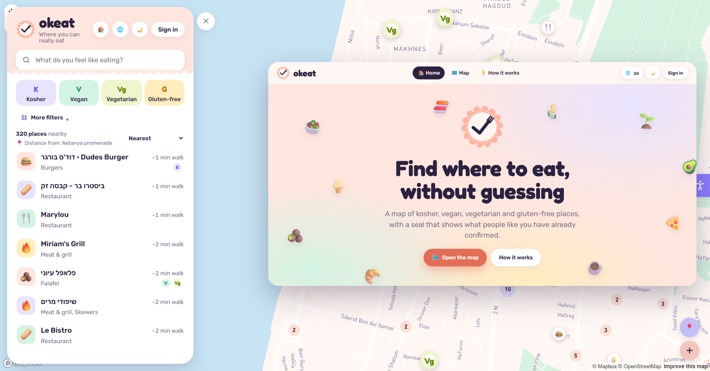
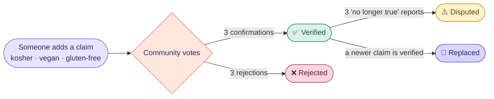
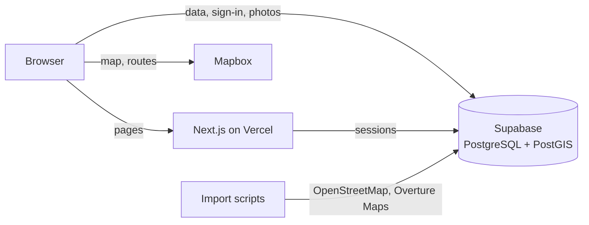

<p align="center">
  <a href="https://okeat.vercel.app"></a>
</p>

<p align="center"><a href="README.he.md"></a></p>

<p align="center">
  <a href="https://okeat.vercel.app"></a>
  <a href="https://okeat.vercel.app/map"></a>
  <a href="docs/ARCHITECTURE.md"></a>
</p>

<p align="center">
  <a href="https://github.com/NoyaAdivi/Okeat/actions/workflows/tests.yml"></a>
  <a href="LICENSE"></a>
  <a href="https://github.com/NoyaAdivi/Okeat/commits/main"></a>
  <a href="https://github.com/NoyaAdivi/Okeat"></a>
</p>

<h3 align="center">OK to eat. Find where you can really eat, without guessing.</h3>

<p align="center">
  Okeat is a bilingual map of <b>20,000+</b> kosher, vegan, vegetarian and gluten-free eateries across Israel.<br>
  Locals add places, other locals confirm them, and the database itself enforces every rule.
</p>

<table align="center">
  <tr>
    <td align="center" width="25%"><a href="https://okeat.vercel.app/map"><b>🗺️ 20,000+</b></a><br><sub>eateries on the map</sub></td>
    <td align="center" width="25%"><a href="#-how-trust-works"><b>✅ 3</b></a><br><sub>confirmations per claim</sub></td>
    <td align="center" width="25%"><a href="https://okeat.vercel.app/cities"><b>🌍 HE · EN</b></a><br><sub>fully bilingual, RTL ready</sub></td>
    <td align="center" width="25%"><a href="https://github.com/NoyaAdivi/Okeat/actions/workflows/tests.yml"><b>🧪 CI</b></a><br><sub>tests on every push</sub></td>
  </tr>
</table>

<p align="center">
  <a href="https://okeat.vercel.app"></a>
</p>

<a name="highlights"></a>
<p align="center"><a href="#see-it-in-action"></a></p>

<table>
  <tr valign="top">
    <td valign="top" width="33%">
      <p><b>🗺️ Find a place to eat</b></p>
      <ul>
        <li><a href="https://okeat.vercel.app/map"><b>Nationwide map</b></a>, clustered so it stays fast</li>
        <li><b>Filters that matter:</b> kosher level and supervising body, vegan, vegetarian, gluten-free, allergies</li>
        <li><b>Smart search:</b> "kosher pizza open now in Ramat Gan" becomes filters and a city</li>
        <li><b>Turn-by-turn navigation</b> with Hebrew voice guidance</li>
      </ul>
    </td>
    <td valign="top" width="33%">
      <p><b>🤝 Information you can trust</b></p>
      <ul>
        <li><b>Every claim needs 3 confirmations</b>, and nobody can confirm their own</li>
        <li><b>Kosher certificates</b> are added as photos and read with OCR</li>
        <li><b>Rules live in the database</b> (Row Level Security and triggers)</li>
        <li><b>Moderators</b> appointed by the admin handle reported places</li>
      </ul>
    </td>
    <td valign="top" width="33%">
      <p><b>💛 Built like a real product</b></p>
      <ul>
        <li><b>Reviews, saved places, shareable lists</b> and photo uploads with approval</li>
        <li><b>Business owners</b> prove ownership with a code</li>
        <li><b>Admin hub</b> that flags duplicates and rough locations by itself</li>
        <li><a href="https://okeat.vercel.app/accessibility"><b>Accessibility menu</b></a>, dark mode, RTL and an installable app</li>
      </ul>
    </td>
  </tr>
</table>

<a name="see-it-in-action"></a>
<p align="center"><a href="#-how-trust-works"></a></p>

<p align="center">
  <a href="https://okeat.vercel.app/map"></a>
</p>

<p align="center">
  <a href="https://okeat.vercel.app"><b>Home</b></a> ·
  <a href="https://okeat.vercel.app/map"><b>Map</b></a> ·
  <a href="https://okeat.vercel.app/cities"><b>Cities</b></a> ·
  <a href="https://okeat.vercel.app/about"><b>How it works</b></a> ·
  <a href="https://okeat.vercel.app/accessibility"><b>Accessibility</b></a>
</p>

<a name="-how-trust-works"></a>
<p align="center"><a href="#tech-stack"></a></p>



<p align="center"><sub>You can't vote on a claim you proposed. Imported and automatic info is labelled and never counts as community-verified.</sub></p>

<a name="tech-stack"></a>
<p align="center"><a href="#data-rules"></a></p>

<p align="center"><b>App</b><br>
<a href="https://nextjs.org"></a>
<a href="https://react.dev"></a>
<a href="https://www.typescriptlang.org"></a>
</p>

<p align="center"><b>Data</b><br>
<a href="https://supabase.com"></a>
<a href="https://www.postgresql.org"></a>
<a href="https://postgis.net"></a>
<a href="https://www.openstreetmap.org"></a>
</p>

<p align="center"><b>Maps &amp; AI</b><br>
<a href="https://www.mapbox.com"></a>
<a href="https://tesseract-ocr.github.io"></a>
<a href="https://www.anthropic.com/claude"></a>
</p>

<p align="center"><b>Ship</b><br>
<a href="https://vercel.com"></a>
<a href="https://github.com/NoyaAdivi/Okeat/actions"></a>
<a href="https://playwright.dev"></a>
</p>

<details>
<summary><b>🏗️ Architecture at a glance</b></summary>
<br>



The browser talks to the database directly, so access rules live in PostgreSQL and hold even without the site. Full write-up in [docs/ARCHITECTURE.md](docs/ARCHITECTURE.md).
</details>

<a name="data-rules"></a>
<p align="center"><a href="#run-locally"></a></p>

| Rule | Where |
|---|---|
| 3 confirmations → `verified`, 3 rejections → `rejected` | `apply_vote()` |
| You can't vote on a claim you proposed | `apply_vote()` |
| A newer verified claim replaces the older one | `apply_vote()` |
| 3 "no longer true" reports → `disputed` | `apply_vote()` |
| Kosher with or without a photo; an expired certificate stops counting | `effective_claims` |
| 3 reports on a place → moderators decide | `after_report()`, `moderate_place()` |
| Moderators are appointed by the admin; people cannot change their own role | Column grants |
| Owner approval needs an admin | `decide_ownership()` |
| Imported / automatic info is labelled and never counts as community-verified | `claims.source` |
| Rate limits on certificate reading and contact messages | `log_extraction()`, `feedback_rate_limit()` |

<a name="run-locally"></a>
<p align="center"><a href="#contact"></a></p>

1. Create free accounts: [Supabase](https://supabase.com), [Mapbox](https://mapbox.com), [Anthropic](https://console.anthropic.com).
2. In Supabase → SQL Editor, run the files in `supabase/migrations/` in order.
3. Copy `.env.example` to `.env.local` and fill in the keys.
4. Install and start:
   ```bash
   npm install
   npm run dev
   ```
   Check the code with `npm run typecheck` and `npm test`.
5. Fill the map:
   ```bash
   npm run import:osm
   npm install @duckdb/node-api && npm run import:overture
   npm run classify
   npm run classify:diet
   ```

> [!IMPORTANT]
> `SUPABASE_SERVICE_ROLE_KEY` is only for the import scripts on your own computer. Never put it in the browser or in your hosting settings.

<details>
<summary><b>📂 Project structure</b></summary>

```
├── src/
│   ├── app/          pages: home, map, place/[id], cities, city/[slug], topic/[slug], u/[id], about, legal pages, API routes
│   ├── components/   MapScreen, MapView, NavPanel, PlaceDetail, FilterBar, dialogs, A11yMenu…
│   └── lib/          data access, types, food types, filters, geo, hours, speech, Supabase clients
├── supabase/
│   ├── migrations/   0001 … 0051 (schema, RLS, functions)
│   └── TEST-SETUP-IN-NEW-SUPABASE.sql   everything in one file, for a fresh test project
├── tests/            automated tests (npm test)
├── tools/            one-click Windows helpers (start, backup, import)
└── scripts/
    ├── import-osm.mjs       import eateries from OpenStreetMap
    ├── import-overture.mjs  import more eateries from Overture Maps
    ├── classify-ai.mjs      give a food type to unclassified places with Claude
    ├── classify-free.mjs    give a food type by name rules, without an API key
    ├── classify-diet.mjs    add vegan, vegetarian and gluten-free guesses, labelled as not confirmed
    ├── fix-locations.mjs    find and fix places with a wrong location
    ├── backup.mjs           back up the database
    └── screenshots.mjs      take screenshots of the site
```
</details>

<details>
<summary><b>🙏 Attribution</b></summary>
<br>
Place data © <a href="https://www.openstreetmap.org/copyright">OpenStreetMap</a> contributors (ODbL) and <a href="https://overturemaps.org">Overture Maps Foundation</a> (CDLA Permissive 2.0). Map © Mapbox.
</details>

<a name="contact"></a>
<p align="center"><a href="https://www.linkedin.com/in/noya-adivi/"></a></p>

<p align="center">
  <a href="https://okeat.vercel.app"></a>
  <a href="https://www.linkedin.com/in/noya-adivi/"></a>
  <a href="https://noyaadivi.github.io/noya-website"></a>
  <a href="https://github.com/NoyaAdivi"></a>
</p>
