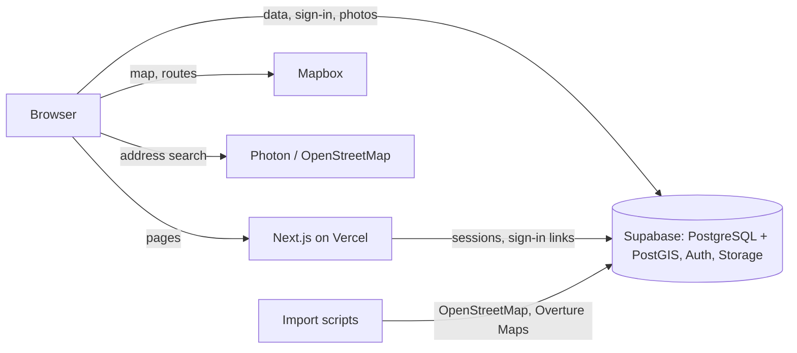

# Okeat architecture

Okeat is a Next.js app on Vercel with Supabase behind it. The browser talks to the database directly, so the access rules live in the database and not only in the UI.

## Folders

| Folder | What is in it |
|---|---|
| `src/app` | Pages and server routes (`/map`, `/admin`, `/auth/*`, `/api/*`) |
| `src/components` | Interface pieces. `MapScreen` holds the map page state, `MapView` draws the map |
| `src/lib` | Data access (`places.ts`), geography, directions, address search, speech |
| `supabase/migrations` | The database, in order: tables, access rules, functions, triggers |
| `supabase/RUN-ME-*` | The same migrations in a form to paste into the SQL Editor |
| `scripts` | Importing places and classifying them |
| `tools` | Windows shortcuts that run the scripts |
| `tests` | Automated tests, run on GitHub on every push |

## How information becomes trusted

1. Someone adds a place or a claim, such as "vegan options". It starts as pending.
2. Other people confirm or reject it. Nobody can confirm their own.
3. Three confirmations mark it as verified. Triggers do this in the database, so the site cannot skip it.
4. A kosher certificate that expired stops counting automatically.

Places can also come from OpenStreetMap, Overture Maps or a guess from the name. These are labelled until people confirm them.

## Main decisions

- **Rules in the database.** Row Level Security and triggers protect the data even if someone calls the API without the site.
- **Moderators are appointed.** Only the admin can give the role, through a checked function, and users cannot change their own role.
- **The map loads light points.** `map_points` returns a small record for each place and the map clusters them, so 20,000 places stay fast.
- **Anonymous accounts.** People can add and confirm without signing up. Reviews, saved places and place photos need a real account.
- **Merging hides.** A merged duplicate is hidden and remembers the place it went into.
- **Free services.** Everything runs on free tiers, and no paid key is needed.

## Sign-in

Google uses the standard redirect through `/auth/callback`. Email sends a link to `/auth/confirm` and a code, so it works even when the link opens in another browser. There are no passwords to store or leak.
